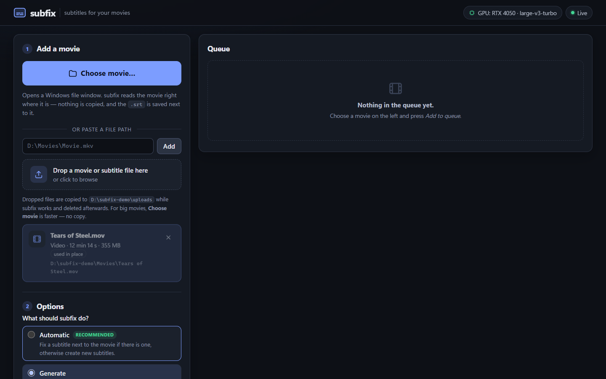
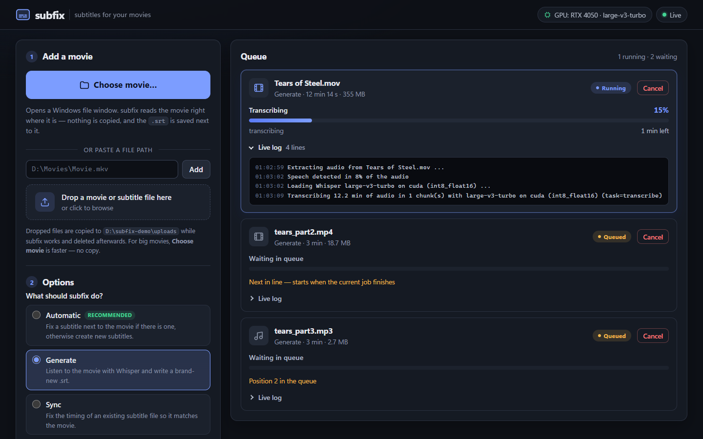
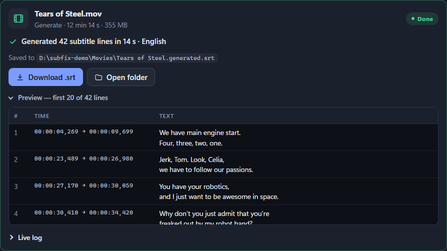
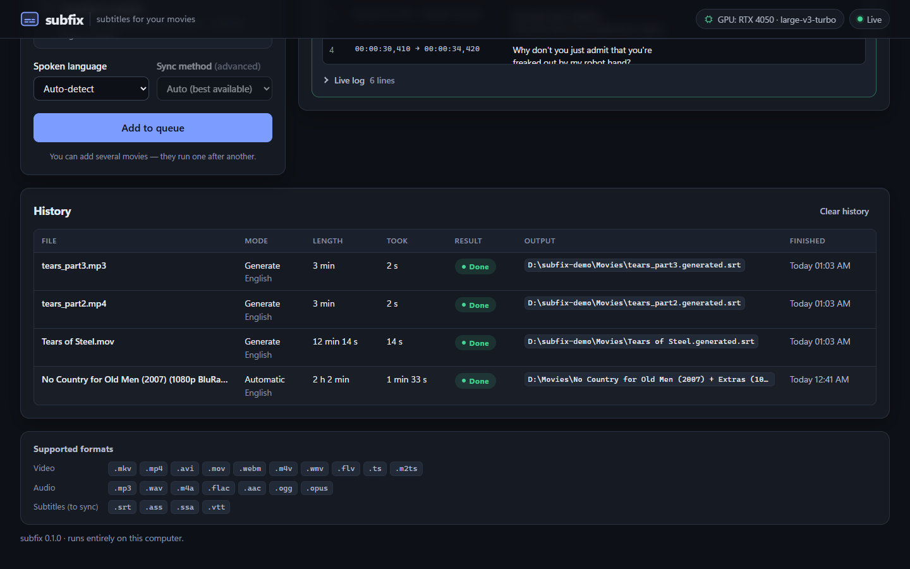
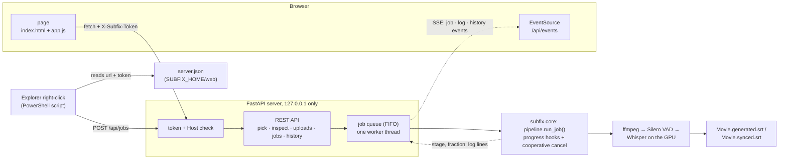
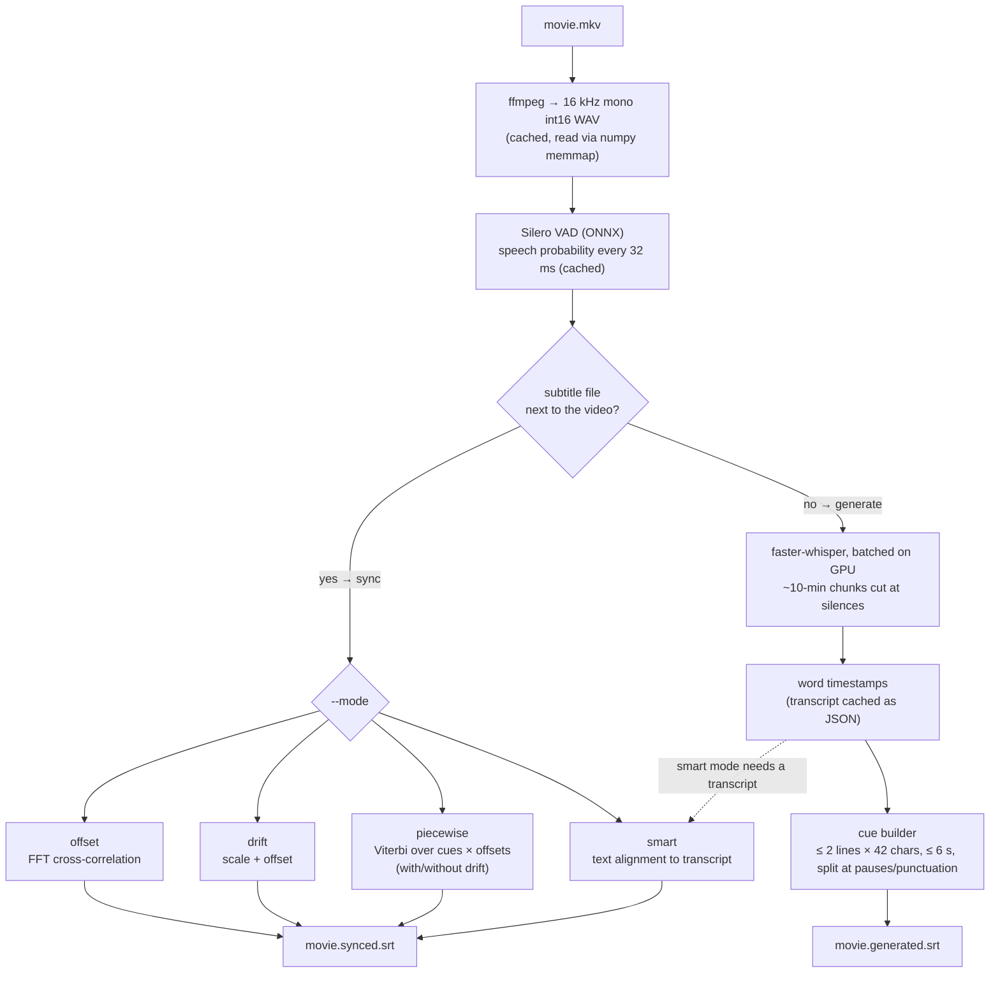
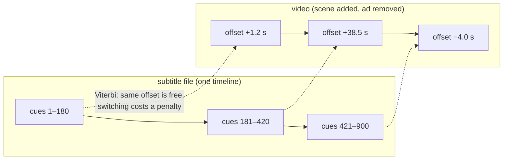
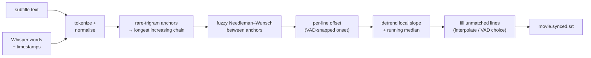

# subfix

**subfix** is a command-line tool, with a local [web UI](#web-ui), that does two things with a
video file. It **generates subtitles** from the audio with
[faster-whisper](https://github.com/SYSTRAN/faster-whisper), either transcribing the original
language or translating to English. It also **fixes subtitles that are out of sync**: a constant
offset, frame-rate drift (25 vs 23.976 fps), different offsets in different parts of the film
(cuts, ads, extended scenes), and a "smart" text-aware mode that keeps the human-written
subtitle text but takes its timing from what Whisper actually heard. subfix never overwrites
your files. Results go next to the video as `movie.synced.srt` or `movie.generated.srt`. If
you'd rather not use a terminal, a desktop shortcut opens the [web UI](#web-ui) in your browser:
choose or drop a movie, and the `.srt` appears next to it.

It is built for an ordinary laptop. The development machine has an RTX 4050 with 6 GB of VRAM,
16 GB of RAM and runs Windows 11. Memory use barely depends on film length (peak 1.9 GB for a
12-minute film, 2.3 GB for a 100-minute one, mostly the Whisper model).

```text
$ subfix movie.mkv
Found subtitles: movie.srt → syncing
…                                   (audio extraction, VAD, transcription progress)
✓ smart: 114/114 lines matched to transcript (100%)  (speech overlap +0.07 → +0.71, 0.1s)
Wrote movie.synced.srt
```

---

## Contents

- [Quick start](#quick-start)
- [Install](#install)
- [Web UI](#web-ui)
- [How it works](#how-it-works)
- [Benchmarks](#benchmarks)
- [mpv plugin](#mpv-plugin)
- [Performance and memory](#performance-and-memory)
- [Limitations](#limitations)
- [Roadmap](#roadmap)
- [Project layout](#project-layout)
- [Development](#development)
- [License and credits](#license-and-credits)

---

## Quick start

```bash
# Automatic: sync the subtitle file next to the video, or generate one if there is none
subfix movie.mkv

# Generate subtitles. --lang is the spoken language; --translate produces English subtitles
subfix generate movie.mkv --lang fr --translate

# Sync a specific subtitle file with a specific algorithm
subfix sync movie.mkv movie.srt --mode drift

# English subtitles for a foreign-language film (Whisper translation)
subfix generate film.mkv --translate

# Show the GPU, the default models, the ffmpeg location and the cache directory
subfix info

# Open the local web UI in the browser (http://127.0.0.1:8765)
subfix web
```

| Command | What it does | Output |
| --- | --- | --- |
| `subfix MOVIE` (same as `subfix auto MOVIE`) | Syncs a sidecar subtitle if one exists, otherwise generates | `MOVIE.synced.srt` or `MOVIE.generated.srt` |
| `subfix generate MOVIE` | Whisper transcription (`--translate` for English) | `MOVIE.generated.srt` |
| `subfix sync MOVIE [SUBS]` | Re-times an existing subtitle file | `MOVIE.synced.srt` |
| `subfix web` | Local [web UI](#web-ui): queue, live progress, history | `.srt` next to the movie |
| `subfix info` | Environment check | none |

Useful options (run `subfix <command> --help` for the full list):

- `--mode auto|offset|drift|piecewise|smart` picks the sync algorithm. `auto` uses smart sync
  on a GPU and audio-only sync on a CPU.
- `--model`, `--device auto|cuda|cpu`, `--compute-type` override the Whisper configuration.
- `--audio-track N` picks the audio track (0 = first). `-o/--output` sets the output path.
- `--no-cache` recomputes audio, VAD and the transcript instead of reusing them.
- `-v` turns on debug logging. `-q` hides everything except warnings and errors.

**Finding the sidecar file.** subfix first looks for `movie.srt`, `.vtt`, `.ass` or `.ssa`
with the same name as the video. If there is none, it looks for `movie.<lang>.srt`-style
variants, preferring English and SRT. It ignores its own `.synced` and `.generated` outputs.
It reads SRT, WebVTT and ASS/SSA in any common encoding and always writes UTF-8 SRT.

**Reading the output line.** The summary names the method and its parameters. The
formats are `offset +X s`, `scale S, offset +X s`, `N segment(s): +a s, +b s, …`, and
`M/N lines matched to transcript` for smart sync. *Speech overlap* is the mean speech score
under the subtitle cues before and after the fix (defined [below](#offset)). Higher means more
cues sit on actual speech. If the score gets worse, subfix prints a warning: the subtitles were
probably already in sync, or they belong to a different cut of the film.

---

## Install

subfix needs Python 3.10 or newer (developed on 3.13) and ffmpeg. You don't need PyTorch:
Silero VAD runs through the ONNX model bundled with faster-whisper.

### Windows + NVIDIA GPU (the tested setup)

```powershell
winget install --id Gyan.FFmpeg.Essentials -e

git clone <this-repo-url> subfix   # or use your existing checkout, e.g. <repo>
cd subfix
py -3.13 -m venv .venv
.venv\Scripts\activate
pip install -e ".[gpu,dev]"

subfix info        # should report "CUDA: available to CTranslate2"
```

- The `gpu` extra installs `nvidia-cublas-cu12==12.4.5.8`. cuDNN is already bundled in the
  CTranslate2 wheel on Windows, so you don't need a separate CUDA Toolkit install. subfix adds
  the pip-installed DLL folders to the search path itself.
- If ffmpeg isn't on `PATH`, subfix also checks the WinGet links folder. You can also point
  `SUBFIX_FFMPEG` at the ffmpeg folder.

**Default models** (chosen by `subfix info` / `device.py`):

| Hardware | Transcribe | Translate (`--translate`) |
| --- | --- | --- |
| CUDA, ≥ 5 GB VRAM | `large-v3-turbo`, `int8_float16` | `large-v3`, `int8_float16` |
| CUDA, 3.5–5 GB | `medium` | `medium` |
| CUDA, less | `small` | `small` |
| CPU | `small`, `int8` | `small`, `int8` |

Translation uses `large-v3` because `large-v3-turbo` was fine-tuned without translation data and
tends to transcribe instead of translate. If a model fails to load or to run its warm-up
inference, subfix tries the next configuration in this order: other compute types → smaller
model → CPU `int8`. It logs the reason each time.

**First run.** The first run downloads the model, about 1.6 GB for `large-v3-turbo` and about
3 GB for `large-v3`. Models, extracted audio, VAD signals and transcripts are cached in
`$SUBFIX_HOME`. When you run from a source checkout, this defaults to `<repo>/.cache`.
Otherwise it's the platform cache directory, for example `%LOCALAPPDATA%\subfix\Cache` on
Windows. To keep the cache on another drive:

```powershell
setx SUBFIX_HOME D:\subfix-cache
```

> **Low disk space on C: / "out of memory" with free VRAM.** On Windows (WDDM), GPU memory
> counts against the system *commit limit*. If C: is nearly full, the page file can't grow, and
> `float16` or `large-v3` can fail with an out-of-memory error even though `nvidia-smi` shows
> free VRAM. That's why `int8_float16` is the default. Freeing space on C:, moving the page file,
> or closing browsers helps. See [SETUP.md](SETUP.md) for details.

### CPU only

```bash
pip install -e ".[dev]"
```

subfix detects that CUDA is unavailable and uses `small` / `int8`. On the development
machine's i5-12450HX that generates subtitles at about 12× real time (a 2-hour film in ~10
minutes). `auto` mode uses the fast audio-only sync on CPU, which takes seconds and doesn't need
Whisper; pass `--mode smart` to transcribe anyway.

### Linux / macOS

Linux and macOS haven't been tested. The code is portable, but there is no benchmark data for
these platforms.

- **Linux + NVIDIA:** run `pip install -e ".[gpu,dev]" "nvidia-cudnn-cu12==9.*"`. You may need
  to add the pip-installed `nvidia/*/lib` folders to `LD_LIBRARY_PATH` (see the faster-whisper
  docs). Install ffmpeg with your package manager.
- **macOS:** run `brew install ffmpeg` and then `pip install -e ".[dev]"`. CTranslate2 has no
  Metal backend, so it runs on the CPU.

---

## Web UI

If you'd rather not use a terminal: double-click the **subfix** shortcut on the Desktop, the
browser opens, choose a movie (or drop it on the page), and when the job is done the `.srt` is
next to the movie. The web UI runs the same code as the CLI and adds a queue, live progress and a
history. It runs entirely on your own machine: the server listens on `127.0.0.1` only and nothing
is uploaded anywhere. It needs only the [install](#install) above.



*The main page: choose or drop a movie, pick the mode and language, add it to the queue.*

### Launching it

1. **Desktop shortcut (recommended).** Run this once from the repository folder:

   ```powershell
   powershell -ExecutionPolicy Bypass -File scripts\windows\create_desktop_shortcut.ps1
   ```

   It puts a **subfix** shortcut on the Desktop that points at `scripts\windows\subfix-web.bat`,
   which starts `.venv\Scripts\subfix.exe web` in a console window titled "subfix web UI".
   Double-click the shortcut to start the server and open the browser. Close that window (or
   press Ctrl+C in it) to stop the server. If the server is already running, starting it again
   just opens the browser on the running one.

2. **From a terminal:**

   ```bash
   subfix web                                  # http://127.0.0.1:8765, opens the default browser
   subfix web --port 9000 --no-browser
   subfix web --upload-dir E:\subfix-uploads   # where drag-and-drop uploads are stored
   ```

   If the port is taken by another program (not a subfix server), `subfix web` stops with a
   message saying so. Pick another `--port`.

3. **Right-click menu in Explorer.** Run this once:

   ```powershell
   powershell -ExecutionPolicy Bypass -File scripts\windows\install_context_menu.ps1
   ```

   Every video and audio file type in the [table below](#supported-formats) then gets a
   **Generate subtitles with subfix** entry. It uses mode *auto*: it syncs a subtitle file next
   to the movie if there is one, and otherwise generates subtitles. On Windows 11 the entry is
   under **Show more options**. The script writes only to `HKEY_CURRENT_USER` (no administrator
   rights, nothing system-wide), and `scripts\windows\uninstall_context_menu.ps1` removes it
   again. If the web UI is running, a right-click job goes into its queue, so only one GPU job
   ever runs at a time and the job also shows up on the page. Otherwise the script runs
   `subfix auto` directly. Either way, a Windows notification shows the output file (or the
   error) when it's done.

See [scripts/windows/README.md](scripts/windows/README.md) for details on the launcher, the
shortcut and the context menu.

### Using it

**1. Pick the file.** There are three ways:

- **Choose movie…** opens the normal Windows *Open* dialog. subfix works on the original file
  where it is, and nothing is copied. Use this for real movies (2–5 GB).
- **Paste a path** to the file into the text box and press *Add*.
- **Drag and drop** the file onto the page. Browsers never tell a web page where a dropped file
  lives, so the file is streamed (with an upload progress bar) into a temporary folder. That is
  `<repo>\.cache\uploads` on the development machine, `<SUBFIX_HOME>\uploads` in
  general, and you can change it with `--upload-dir` or the `SUBFIX_UPLOAD_DIR` environment
  variable. The folder is refused if it is on the Windows system drive, unless you set
  `SUBFIX_ALLOW_SYSTEM_DRIVE_UPLOADS=1`: a full C: drive also breaks GPU allocations (see
  [Install](#windows--nvidia-gpu-the-tested-setup)). An upload bigger than the drive's free
  space minus 1 GB is refused before anything is written. The copy is deleted when its job ends
  (done, failed or cancelled). Aborted uploads and leftovers from an earlier run are cleaned up
  too.

For syncing, you can add a subtitle file the same way (**Choose subtitles**, or drop a `.srt`,
`.ass`, `.ssa` or `.vtt` file). Without one, subfix looks for a subtitle file next to the movie
with the same rules as the CLI (see *Finding the sidecar file* in [Quick start](#quick-start)).

**2. Pick the options.**

- **Mode:** *Auto* (sync the subtitles if there are any, otherwise generate), *Generate* or
  *Sync*.
- **Translate to English:** Whisper translation (with `large-v3`) when generating subtitles. It
  is ignored when syncing.
- **Language:** the spoken language. The default is *Auto-detect*; all 100 Whisper languages are
  listed.
- **Sync method:** *auto*, *offset*, *drift*, *piecewise* or *smart*, the same as `--mode` on the
  command line (see [How it works](#how-it-works)).

**3. Add to queue.** You can queue several files. They run one at a time, in order, on the GPU.
Each job card shows the current stage (*Extracting audio → Detecting speech → Loading Whisper
model → Transcribing → Synchronising → Writing subtitles*; cached steps finish at once), a
progress bar for the whole job, an ETA and the live log lines. **Cancel** removes a queued job
immediately. A running job stops cooperatively: ffmpeg is killed within about a second, and
Whisper stops after the current batch. The Whisper model stays loaded between queued jobs and is
released after the queue has been idle for two minutes.

**4. The result.** A finished job shows a summary (for example `generated 76 cues (en)`),
**Download .srt**, **Open folder** (Explorer with the file selected) and a preview of the first
20 subtitle lines. Every job that finishes, fails or is cancelled is added to the **history**.
The history is kept across restarts in `<SUBFIX_HOME>\web\history.jsonl` (the last 500 jobs).
Clearing the history never deletes a `.srt` file.

**Where the `.srt` is saved:**

| Movie came from | Output |
| --- | --- |
| *Choose movie…* or a pasted path | Next to the movie, with the same names as the CLI: `Movie.generated.srt` or `Movie.synced.srt`. If that folder isn't writable, the file goes to the outputs folder below and the result card says so. |
| Drag and drop | `<SUBFIX_HOME>\web\outputs\<job id>\Movie.generated.srt` (or `.synced.srt`), which is `<repo>\.cache\web\outputs\…` on the development machine. Use **Download .srt** or **Open folder** to get it. |



*A job in progress: the current stage, overall progress, ETA and the live log.*



*A finished job: summary, Download .srt, Open folder and a preview of the first 20 lines.*



*History (file, mode, length, time taken, output path) and the supported formats.*

Measured in the end-to-end test on the RTX 4050 (`tests/e2e/web_e2e.py`, real server, real
GPU): the full 12-minute *Tears of Steel* was transcribed in 12.4 s, and the 3-minute clips
queued behind it took about 2 s each because the model stays loaded between jobs. Cancelling
during transcription stopped the job 4.6 s later with no output written; a dropped 18.7 MB
file was streamed to `<repo>\.cache\uploads` and deleted when its job finished.

The screenshots show *Tears of Steel* (© Blender Foundation,
[mango.blender.org](https://mango.blender.org), CC BY 3.0).

### Supported formats

| Kind | Extensions |
| --- | --- |
| Video | `.mkv` `.mp4` `.avi` `.mov` `.webm` `.m4v` `.wmv` `.flv` `.ts` `.m2ts` |
| Audio | `.mp3` `.wav` `.m4a` `.flac` `.aac` `.ogg` `.opus` |
| Subtitles (input for sync) | `.srt` `.ass` `.ssa` `.vtt` |

Files are matched by extension, ignoring case. Anything else is rejected with a message that
lists these types. The list lives in [`subfix/formats.py`](subfix/formats.py) and was verified,
not assumed: an 8-second clip was encoded into each of the 17 video and audio containers with
ffmpeg 9.0.2 and decoded by subfix's audio extraction, and all 17 worked. The output is always a
UTF-8 `.srt`.

### How the web UI works



- **Jobs run in-process.** The worker thread calls `pipeline.run_job()`, the same code path as
  the CLI, inside a `progress.use(JobControl)` context. The core's loops (ffmpeg, VAD chunks,
  Whisper segments) report their stage and progress to it and check its cancel flag. The CLI
  never sets a controller, so it pays nothing. This gives finer progress than parsing the output
  of a subprocess, and it lets the server keep the Whisper model loaded between queued jobs.
- **Live updates use server-sent events.** One `GET /api/events` stream carries `job` updates
  (at most 4 per second per job), `log` lines and `history` entries. Data only flows from the
  server to the page, so SSE is enough. `EventSource` reconnects on its own, and the page then
  re-fetches the job list and history. Commands (add, cancel, open folder) are ordinary JSON
  requests.
- **The file picker runs in a separate Python process** (tkinter), so a GUI toolkit never runs
  inside the server's threads. It returns the original path, and no copy is made.
- **One GPU queue for everything.** While it runs, the server writes `server.json` (URL and
  token) to `<SUBFIX_HOME>\web\` and deletes it on shutdown. The right-click script uses it to
  submit to the running server instead of starting a second GPU job.

The full API (endpoints, events, error codes) is specified in [docs/WEB_API.md](docs/WEB_API.md).

### Security and privacy

The server binds to `127.0.0.1` only, and there is no option to expose it on the network. Being
local isn't enough on its own: any website open in your browser can send requests to
`http://127.0.0.1:8765`, and a DNS-rebinding page can even read the answers. So every API call
must carry a random token that is generated for each server run and injected into the page, and
requests whose `Host` header isn't `127.0.0.1:<port>` or `localhost:<port>` are rejected.
Without these checks, a malicious page could queue jobs on arbitrary paths or open folders.
Your files never leave the machine. Dropped files are only copied to a local temporary folder,
and the page loads no CDN scripts, web fonts or analytics, so it works offline.

---

## How it works



The audio-only methods (offset, drift and piecewise) score a candidate timing in the same way.
A subtitle shown while someone is speaking earns credit, and a subtitle shown over silence
loses credit:

```text
score = Σ_t  sub(t) · (p_speech(t) − θ)
```

Here `sub(t)` is 1 while a cue is on screen, `p_speech` is the VAD probability, and both are
sampled on a 10 ms grid. Sound descriptions (`[door slams]`, `♪ …`) and very long cues are left
out of the estimate, but they are still shifted.

### offset

This mode applies one constant shift to the whole file. subfix cross-correlates the subtitle
on/off signal with the reference `p − θ`, so every offset up to ±15 minutes is scored in a
single FFT. `θ` is the film's own mean speech probability, an adaptive threshold. A fixed
threshold of 0.5 doesn't work, because Silero often outputs only 0.1–0.4 for real dialogue under
music while true non-speech sits near 0. Positions outside the audio are scored worse than
silence, so cues can't be "parked" off the ends of the film. The peak is then refined below one
frame by fitting a parabola through it and its two neighbours.

### drift

This mode solves `t' = scale · t + offset`, which is the error you get when subtitles timed for
a 25 fps release are played against a 23.976 fps video. The candidate scales are 1.0, every
ratio of the common frame rates (23.976 / 24 / 25 / 29.97 / 30), and one data-driven estimate.
That estimate is a robust Theil–Sen line fitted through offsets measured in sliding windows.
subfix finds the best offset for each candidate scale with the FFT method above, then refines
the winning scale with a golden-section search.

### piecewise

This mode handles different offsets in different parts of the film, for example after a cut
scene or an inserted ad break. Each cue `i` gets an offset `o_i` from a candidate set, and a
Viterbi dynamic program maximises the total score minus a penalty for every change of offset.
The candidates are the strongest cross-correlation peaks of short sliding windows, each expanded
to a fine 10 ms neighbourhood. The split penalty is measured in *seconds of well-aligned
speech* for this particular film, so it behaves the same on clean audio and under a loud score.
A hard constraint keeps cues in their original order: a switch can't make a cue start before the
previous one ends. With prefix sums and a prefix-max, each DP step costs O(K), so the whole run
is O(N·K).



In practice, `--mode piecewise` (and `auto` on a CPU) runs `sync_audio` in `pipeline.py`. That
function first fits a global drift. It then runs piecewise both with and without that drift
correction and keeps the better result, with ties going to the simpler model. If the result is a
single segment, it is reported as plain drift or offset.

### smart

This mode keeps the human-written subtitle text and takes its timing from Whisper:

1. **Tokenize** both sides: lower-case the text, strip tags, sound descriptions and speaker
   labels, and normalise spellings such as `mr → mister` and `gonna → going`.
2. **Find anchors.** Word trigrams that are rare on both sides are matched. The longest chain
   that is increasing on both sides (longest increasing subsequence) keeps only the
   order-consistent matches. Text order isn't affected by timing errors, so this works the same
   for offset, drift and cuts.
3. **Fill the gaps.** Between anchors, a fuzzy Needleman–Wunsch alignment matches the remaining
   words, using [rapidfuzz](https://github.com/rapidfuzz/RapidFuzz) similarity so it tolerates
   small spelling differences.
4. **Compute per-line offsets.** For each line, subfix takes the start of its first matched word
   and moves it to the first VAD speech frame. Whisper's first word in a segment tends to start
   100–400 ms early, in the silence before it. The time needed to speak any unmatched words
   before that word is then subtracted.
5. **Smooth.** subfix removes a local drift slope, then applies a running median over
   neighbouring lines. This removes Whisper timing noise and bad matches while keeping real steps
   (cuts) sharp.
6. **Unmatched lines** are interpolated between their neighbours when the two agree. Otherwise
   they take whichever neighbour's offset puts them on more detected speech.



If too few lines match, subfix falls back in two steps. If the subtitles look English but the
audio isn't English, it aligns against Whisper's English *translation* of the audio. Otherwise
it falls back to audio-only sync and says so in its output.

### auto

`subfix sync --mode auto`, which is the default, uses **smart** sync when a CUDA GPU is
available. Transcribing a film on a GPU takes minutes and gives the most accurate timing. On a
CPU, it uses **audio-only** sync (drift + piecewise), which takes seconds and needs no Whisper
model.

### generate

subfix splits the audio into ~10-minute chunks, placing each cut in the quietest point of the
VAD signal near the boundary. Each chunk goes through faster-whisper's batched pipeline with
word timestamps. Likely hallucinations are dropped, such as "Thanks for watching" on
low-confidence segments and repetition loops. Words are then grouped into cues of at most 2
lines × 42 characters and about 6 s each. A cue is broken at sentence punctuation or at a pause,
and every cue stays on screen for at least about 0.8 s.

---

## Benchmarks

> Full tables, per-run details and the commands to reproduce them are in
> [benchmarks/RESULTS.md](benchmarks/RESULTS.md).

**Test material.**

- **Synthetic films** of 12 and 100 minutes. Sentences from *The Adventures of Sherlock Holmes*
  (Project Gutenberg) are spoken by the Windows SAPI voices at random rates. The films include
  random pauses, stretches of synthetic music, and a pink-noise floor throughout. The ground
  truth is exact: every sentence's speech span is known to the millisecond.
  ([`make_synthetic.py`](benchmarks/make_synthetic.py), [`tts.ps1`](benchmarks/tts.ps1))
- **A real film:** *Tears of Steel* (Blender Foundation, CC-BY) with its official, human-timed
  English subtitles as the reference.

**Corruptions** ([`corrupt.py`](benchmarks/corrupt.py), deterministic seeds):

- **offset:** a random shift of 1.5–45 s.
- **drift:** a frame-rate ratio such as 25/23.976 or 24/25, plus a random offset.
- **piecewise:** 2–4 sections with different offsets. When a section moves *earlier*, the
  overlapping lines are removed, just as a real subtitle file has no lines for inserted footage.

**Metrics:** mean and median absolute error of cue start times, and the percentage of lines
within 200 ms of the truth.

% of lines within 200 ms of the truth (median error in ms), 5 random corruptions each:

| Corruption | Material | uncorrected | offset | drift | piecewise | smart |
| --- | --- | ---: | ---: | ---: | ---: | ---: |
| offset | Synthetic (12 + 100 min) | 0.0% (30.4 s) | 100.0% (20 ms) | 100.0% (20 ms) | 100.0% (20 ms) | 100.0% (22 ms) |
| offset | Tears of Steel (EN subs) | 0.0% (30.4 s) | 100.0% (120 ms) | 100.0% (111 ms) | 100.0% (111 ms) | 100.0% (63 ms) |
| drift | Synthetic (12 + 100 min) | 1.3% (71.6 s) | 2.7% (45.2 s) | 100.0% (20 ms) | 100.0% (20 ms) | 100.0% (23 ms) |
| drift | Tears of Steel (EN subs) | 0.0% (8.7 s) | 16.6% (3.5 s) | 100.0% (121 ms) | 100.0% (121 ms) | 94.5% (64 ms) |
| piecewise | Synthetic (12 + 100 min) | 0.0% (5.6 s) | 61.4% (21 ms) | 61.4% (22 ms) | 100.0% (19 ms) | 100.0% (19 ms) |
| piecewise | Tears of Steel (EN subs) | 0.0% (5.6 s) | 44.4% (207 ms) | 44.4% (377 ms) | 84.8% (126 ms) | 86.2% (52 ms) |

Across all 19,251 corrupted cue placements, smart sync puts **99.4 %** of lines within 200 ms
of the truth (median error 21 ms) and audio-only sync (`--mode piecewise`, no Whisper) also
**99.4 %** (median 20 ms); uncorrected it is 0.4 %. On the synthetic films every mode that
matches the corruption is at 100 %. On the real film the picture is more nuanced: smart sync is
the most *precise* (median 52–64 ms vs 111–126 ms for audio-only — text pins the position even
under a loud score), but both drop to ~85 % within 200 ms when the cut lands in the film's
climax, where neither VAD nor Whisper hears the shouted lines.

Subtitle generation (`subfix generate`, end to end without cache) runs at **76× real time** on
the 100-minute film with `large-v3-turbo` / `int8_float16` on the RTX 4050 (79 s, WER 2.1 %),
and at **12× real time on the CPU alone** with `small` / `int8` (WER 3.1 %). Translation
(`--translate`, `large-v3`) was checked on a German LibriVox recording: 91 s of audio in 21 s,
fluent English output.

---

## mpv plugin

A small Lua script for [mpv](https://mpv.io) runs subfix on the file you're watching. It
syncs the sidecar subtitle, or generates one if there isn't any, and loads the result as soon as
it's ready. The default key is **Ctrl+Shift+S**. The plugin calls the CLI with a hidden
`--status` flag and reads the machine-readable `SUBFIX-STATUS:` / `SUBFIX-OUTPUT:` /
`SUBFIX-ERROR:` lines it prints. See [plugins/mpv/README.md](plugins/mpv/README.md) for
installation and options.

---

## Performance and memory

- **Audio** is extracted once to a 16 kHz mono int16 WAV in the cache. A 3-hour film takes
  ~345 MB. The WAV is read through `numpy.memmap` and never loaded fully into RAM.
- **Surround sound:** for 5.1/7.1 tracks subfix extracts mostly the centre channel
  (`0.8·FC + 0.1·FL + 0.1·FR`), where films put dialogue. In a test with speech on the centre
  channel and loud noise on the other five, the extracted audio correlated 0.95 with the clean
  speech versus 0.31 for a plain downmix.
- **VAD** runs Silero over fixed 10-minute chunks of the memory-mapped audio. The resulting
  probability signal (one float per 32 ms) is cached as `.npy`.
- **Whisper** gets ~10-minute chunks cut at silences, batched on the GPU. Each chunk is freed
  before the next one is read.
- **Transcripts** are cached as JSON for each combination of audio, model, task and language.
  Re-syncing the same film with a different subtitle file, or switching from `generate` to
  `sync`, reuses the transcript and finishes in seconds.
- **Sync** works on 10 ms grids with FFTs and prefix sums. The audio-only methods take seconds
  even for long films.

On the 100-minute synthetic film, a full `generate` run without a cache takes **79 s**. Peak
resident memory of the whole process tree is **2.1 GB**, versus 1.9 GB for the 12-minute film:
memory is dominated by the model, not by the film length. Audio-only sync of the 100-minute
film takes 6–13 s; smart sync takes ~4 s once the transcript is cached.

---

## Limitations

- **subfix needs speech.** Films with very little dialogue, or music videos, give the
  algorithms little to work with.
- **Language mismatch.** Smart sync needs the subtitles to be in the language that is spoken.
  If the subtitles are English and the audio isn't, subfix aligns against Whisper's English
  translation, which is looser and slower. For any other language pair, only audio-only sync
  works, and it can't use the text at all.
- **Loud music and effects** reduce Silero's speech probabilities. The adaptive threshold helps,
  but audio-only sync is clearly less precise on films with heavy scores than on clean dialogue.
  Sections that are only shouting over music (Tears of Steel's climax) defeat both VAD and
  Whisper; a cut that falls there can leave those lines misplaced.
- **Repeated dialogue** (a scene that replays earlier lines with the same rhythm) can make
  audio-only piecewise sync ambiguous; smart sync resolves it through text order.
- **One global drift.** Audio-only sync models a single scale plus piecewise offsets. Sections
  with *different* frame-rate errors, or scenes that were reordered, aren't handled. Cues are
  never reordered. Very short sections with only a few lines may get absorbed into their
  neighbours rather than paying the split penalty.
- **Translation uses `large-v3`,** which needs more VRAM and RAM and is slower than turbo. On a
  memory-constrained Windows machine it may fall back to `medium`.
- **Generated subtitles** have no speaker separation. Cue splitting follows simple heuristics,
  and the hallucination filter is heuristic too.
- **External subtitle files only.** Subtitle tracks embedded in an MKV aren't read yet. Only one
  audio track is used per run (`--audio-track`).
- **The mpv plugin** doesn't show a real progress bar: mpv only hands over subfix's output when
  it exits, so the OSD shows what is being done and an elapsed timer.
- **Web UI progress is coarse in places.** Loading the model has no measurable progress, and
  the transcription bar moves each time Whisper finishes a batch of 8 speech segments (up to
  ~4 minutes of speech). Dialogue-heavy films update often; a film with little dialogue (such
  as *Tears of Steel*, speech in 8 % of its runtime) can jump from the start of transcription
  straight to done. The ETA is an estimate and is rough at the start of a job.
- **Notifications need Windows notifications switched on** (*Settings → System →
  Notifications*). If they are off, the right-click menu still works but only writes the
  result to `<SUBFIX_HOME>\web\context-menu.log`.
- **Cancelling is cooperative.** ffmpeg is killed within about a second, but Whisper only stops
  after the batch it is working on (a few seconds in the worst case).
- **Drag and drop copies the file.** Browsers don't reveal a dropped file's path, so the whole
  movie is streamed into the upload folder first. That needs as much free space as the movie,
  and the `.srt` ends up in the web outputs folder instead of next to the movie. *Choose
  movie…* or a pasted path avoids both.
- **The web UI is single-user and local.** It serves `127.0.0.1` only and runs one GPU job at a
  time. The job list on the page covers the current server run; older jobs are in the history.
- **The launcher, desktop shortcut, right-click menu and notifications are Windows-only.**
  `subfix web` itself is plain Python but hasn't been tested on Linux or macOS. The native file
  picker needs tkinter; without it, paste a path or use drag and drop.
- **Tested platform:** subfix was developed and benchmarked on Windows 11 with one NVIDIA GPU.
  Linux and macOS haven't been tested.

---

## Roadmap

- Read and sync subtitle tracks embedded in MKV/MP4.
- Speaker-aware cue splitting for generated subtitles.
- A VLC extension.
- Web UI launcher and file-manager integration for Linux and macOS (the current scripts are
  Windows-only).
- Packaging: a PyPI release and a standalone Windows build.

---

## Project layout

```text
subfix/
├── cli.py            # Typer CLI: auto / generate / sync / web / info
├── pipeline.py       # Context (lazy audio/VAD/transcript), generate, sync, auto, fallbacks,
│                     #   run_job() (the single entry point used by the web UI)
├── progress.py       # progress callbacks + cooperative cancellation (no-op for the CLI)
├── formats.py        # supported file extensions, Whisper language names
├── log.py            # console, logging and progress-bar helpers (rich)
├── audio.py          # ffmpeg extraction → cached WAV, memmap reader
├── vad.py            # Silero VAD (ONNX) speech-probability signal, chunked + cached
├── transcribe.py     # chunked batched faster-whisper, word timestamps, JSON cache
├── cues.py           # words → readable subtitle cues
├── device.py         # GPU detection, CUDA DLL setup, model loading with fallback chain
├── srt_io.py         # tolerant SRT/VTT/ASS reader, encoding detection, SRT writer
├── config.py         # cache location, defaults
├── sync/
│   ├── common.py     # shared scoring signal, FFT cross-correlation
│   ├── offset.py
│   ├── drift.py
│   ├── piecewise.py  # Viterbi
│   └── smart.py      # text alignment
└── web/              # local web UI (subfix web)
    ├── server.py     # FastAPI app on 127.0.0.1: token + Host check, SSE, server.json
    ├── jobs.py       # FIFO queue, one worker thread, progress → events
    ├── uploads.py    # streamed drag-and-drop uploads
    ├── picker.py     # native Open dialog (tkinter, separate process)
    ├── history.py    # history.jsonl
    ├── common.py     # API errors, timestamps, path helpers
    └── static/       # index.html, app.js, style.css (no build step, no CDN)
scripts/windows/      # web UI launcher (.bat), desktop shortcut, HKCU right-click menu,
                      #   notifications; see scripts/windows/README.md
plugins/mpv/          # mpv Lua plugin + README
benchmarks/           # synthetic film generator, corruptions, memory probe, RESULTS.md
docs/
├── WEB_API.md        # web UI API and integration contract
└── images/           # web UI screenshots
tests/                # pytest unit tests (synthetic signals, no GPU needed)
├── web/              # web API tests with a mocked pipeline (no GPU)
└── web_frontend/     # mock server implementing the contract + browser tests for the page
SETUP.md              # Windows setup notes (commit limit, page file, cache)
DECISIONS.md          # design decisions and what was tried
SYSTEM_REPORT.md      # hardware/software inventory of the development machine
```

---

## Development

```bash
pip install -e ".[dev]"
pytest            # unit tests + web API tests; synthetic data and a mocked pipeline, no audio or GPU
ruff check .      # lint
```

Design decisions, including dead ends and the reasons for the pinned versions, are recorded in
[DECISIONS.md](DECISIONS.md). The web UI's API (endpoints, events, error codes, page selectors
used by the tests) is specified in [docs/WEB_API.md](docs/WEB_API.md).

---

## License and credits

subfix is released under the [MIT License](LICENSE).

It builds on:

- [faster-whisper](https://github.com/SYSTRAN/faster-whisper) and
  [CTranslate2](https://github.com/OpenNMT/CTranslate2) for fast Whisper inference, with
  [Whisper](https://github.com/openai/whisper) models by OpenAI.
- [Silero VAD](https://github.com/snakers4/silero-vad) for voice activity detection, using the
  ONNX model bundled with faster-whisper.
- [FFmpeg](https://ffmpeg.org), [rapidfuzz](https://github.com/rapidfuzz/RapidFuzz),
  [pysubs2](https://github.com/tkarabela/pysubs2), [Typer](https://typer.tiangolo.com),
  [Rich](https://github.com/Textualize/rich), and [FastAPI](https://fastapi.tiangolo.com) with
  [Uvicorn](https://www.uvicorn.org) for the web UI.

Benchmark material and web UI screenshots:

- *Tears of Steel* © Blender Foundation, [mango.blender.org](https://mango.blender.org),
  licensed under CC BY 3.0.
- *The Adventures of Sherlock Holmes* by Arthur Conan Doyle, from
  [Project Gutenberg](https://www.gutenberg.org/ebooks/1661) (public domain).
